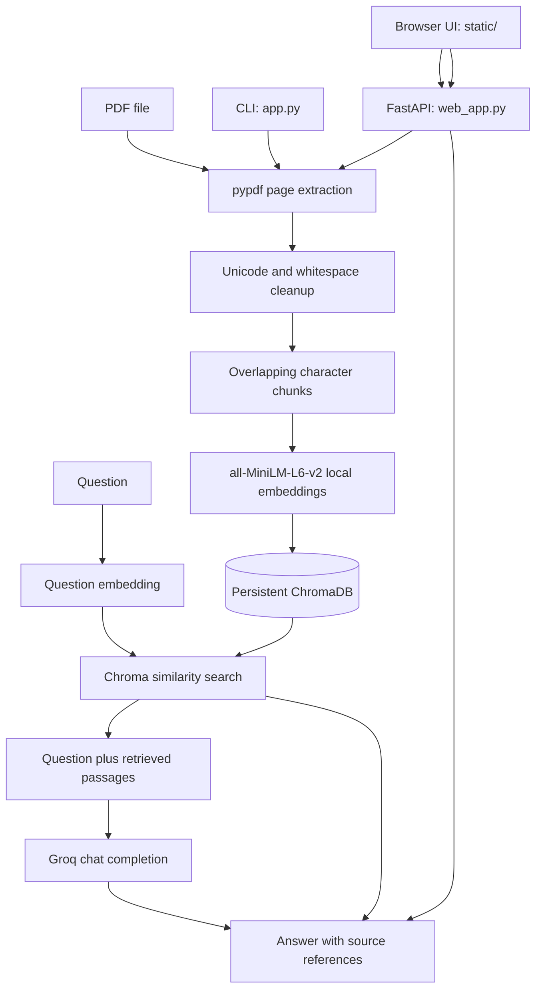

# Project Guide

This guide explains how the app is organized, how a PDF becomes a cited
answer, and what each project file is responsible for. For installation and
quick-start commands, see the [README](README.md).

## 1. What the project does

This application lets a user ask questions about one or more text-based PDFs.
It uses **Retrieval-Augmented Generation (RAG)**:

1. Prepare searchable passages from documents.
2. Find passages that are relevant to a question.
3. Give only those passages and the question to a language model.
4. Return the answer together with references to the source documents.

The project writes the retrieval steps itself. It does not use a framework
such as LangChain or LlamaIndex.

## 2. System at a glance



### Technologies and their roles

| Technology | Role |
|---|---|
| Python 3.10+ | Runs the CLI, API, and RAG pipeline. |
| pypdf | Reads text page by page and provides page numbers for citations. |
| `all-MiniLM-L6-v2` | Creates local vector embeddings for passages and questions. |
| ChromaDB | Stores vectors and metadata on disk and finds similar passages. |
| FastAPI | Exposes the local browser application's API. |
| Uvicorn | Runs the FastAPI server on the local machine. |
| Groq Python SDK | Sends the question and retrieved context to the configured Groq model. |
| python-dotenv | Loads `GROQ_API_KEY` from the local `.env` file. |

## 3. How indexing works

Indexing prepares PDFs before questions are asked.

1. **Select input**
   - The CLI accepts a PDF file or a folder. Folder traversal is recursive
     only when `--recursive` is supplied.
   - The browser accepts uploaded PDF files and saves each under a generated
     local filename.
2. **Extract pages**  
   `pypdf.PdfReader` reads each page. Pages are processed individually so the
   app can attach the correct source page to every chunk.
3. **Clean text**  
   `clean_text()` applies Unicode NFKC normalization, joins words split by a
   hyphen at a line ending, joins single line breaks, and collapses repeated
   spaces while preserving paragraph breaks.
4. **Create chunks**  
   `chunk_text()` slices page text into character windows. The CLI defaults to
   500 characters with 100 characters of overlap. Overlap keeps a little
   neighboring context at chunk boundaries.
5. **Create embeddings**  
   `SentenceTransformer("all-MiniLM-L6-v2")` converts every chunk to a numeric
   vector locally. The first run downloads the model; later runs use the local
   model cache.
6. **Store text and metadata**  
   Chroma stores the vector with its text and source information. The CLI
   stores a chunk number, filename, and page. The browser collection also
   stores a document ID so one uploaded file's chunks can be removed without
   deleting other uploaded files.

The model converts text into a vector so passages with similar meaning can be
retrieved even when they do not use exactly the same words as a question.

## 4. How question answering works

For each question:

1. The embedding model converts the question to a vector.
2. Chroma compares that vector with stored chunk vectors and returns the
   closest passages. The CLI uses `--top-k` (default 3); the browser uses the
   `TOP_K` constant (3).
3. `build_prompt()` combines the question and passages. It tells the model to
   answer using only the supplied context, use clear language, and return the
   exact fallback sentence when the context does not contain the answer.
4. `ask_llm()` calls the Groq chat-completions API using the `MODEL` constant
   and temperature `0.1`.
5. The interface displays the answer and source passages. Sources contain the
   PDF filename and page; CLI output also shows the chunk number and retrieval
   distance.

The model can still misunderstand text or produce an incomplete answer.
Always inspect the cited passages for important information.

## 5. What each file does

### `app.py` — RAG pipeline and CLI

This is the shared source of the RAG logic. Its main functions are:

| Function | Responsibility |
|---|---|
| `extract_text(pdf_path)` | Extracts text page by page and prints a page count and extraction preview. |
| `clean_text(text)` | Normalizes Unicode and PDF line-break whitespace. |
| `chunk_text(text, chunk_size, overlap)` | Splits text into overlapping character chunks. |
| `build_index(chunks, sources)` | Rebuilds the CLI Chroma collection and stores embeddings and citations. |
| `retrieve(question, k)` | Embeds a question and returns similar chunks with source metadata. |
| `build_prompt(question, retrieved_chunks)` | Builds the context-grounded instruction for the LLM. |
| `ask_llm(prompt)` | Calls Groq and returns the generated answer. |
| `parse_args(argv)` | Parses the input path and CLI tuning options. |
| `main(argv)` | Coordinates input validation, indexing, the question loop, debug output, and citations. |

The settings near the top of the file include `CHUNK_SIZE`, `OVERLAP`,
`TOP_K`, `MODEL`, and `EMBED_MODEL`. CLI flags can override chunk size,
overlap, and top-k.

The CLI stores its data in the `pdf_chunks` collection. It deletes and rebuilds
that collection on every run from the selected input. Thus, it is not an
incremental CLI index.

### `web_app.py` — local web server and API

This file defines the FastAPI application and endpoints used by the browser:

| Route | What it does |
|---|---|
| `GET /` | Serves `static/index.html`. |
| `GET /api/documents` | Returns the current document list and indexing statuses. |
| `POST /api/documents` | Validates and saves PDF uploads, then starts indexing. Each file is limited to 50 MB. |
| `DELETE /api/documents/{document_id}` | Removes a completed or failed upload and only its Chroma chunks. |
| `GET /api/documents/{document_id}/file` | Serves the uploaded PDF inline so the browser can open a cited page. |
| `POST /api/questions` | Embeds a question, retrieves context, calls Groq, and returns the answer and sources. |

The server loads `.env` during startup. Uploaded files and `documents.json`
are saved in `user_documents/`. The web UI uses a separate `web_pdf_chunks`
collection, so its uploads survive a restart and are separate from the
CLI's rebuild-on-start collection.

`documents.json` tracks each upload's generated ID, original filename, local
stored filename, status, page count, chunk count, progress, and any indexing
error. If the server stops during indexing, the next startup marks that item
as an error rather than claiming that indexing succeeded.

### `static/index.html` — interface structure

Defines the browser page structure: document sidebar, PDF upload/drop target,
privacy note, chat area, question form, and source panel. It loads the CSS and
JavaScript from `/static/`.

### `static/styles.css` — presentation

Defines the layout, colors, document cards, progress indicators, chat bubbles,
source passages, responsive layout, and status/error styling.

### `static/app.js` — browser behavior

Connects the interface to the API. It:

- uploads selected or dropped PDFs;
- refreshes document status from `GET /api/documents`;
- removes documents through the delete route;
- posts questions and renders answers and citations;
- formats basic Markdown (paragraphs, headings, lists, bold, italics, and code);
- opens the selected source's PDF at the cited page; and
- displays upload, API, and Groq errors.

The page polls document status approximately every 1.2 seconds while open.

### `tests/` — offline checks

- `tests/test_app.py` checks text cleanup, chunk boundaries, CLI settings,
  chunk metadata, retrieval shape, and prompt instructions.
- `tests/test_web_app.py` checks the HTML/static routes, API behavior, dotenv
  startup, and upload-file persistence using mocked services and temporary
  files.

These tests do not contact Groq or measure answer quality.

### `requirements.txt` — dependencies

Lists the packages needed by both the CLI and browser application. Install
them into the active virtual environment with:

```powershell
python -m pip install -r requirements.txt
```

### `.gitignore` — local/private data protection

Excludes `.env`, local PDFs in `data/`, browser uploads, Chroma data, Python
bytecode, and virtual environments. Check this file before adding any new local
data folders to the project.

## 6. Local storage and separation

| Data | Location | Lifetime |
|---|---|---|
| Groq key | `.env` | Persists locally; ignored by Git. |
| CLI source PDFs | User-selected path, commonly `data/` | Remain where the user placed them. |
| Browser-uploaded PDFs | `user_documents/` | Persist until removed by the user. |
| Browser upload state | `user_documents/documents.json` | Persists across server restarts. |
| CLI vectors | `chroma_db/`, collection `pdf_chunks` | Collection rebuilt each CLI run. |
| Browser vectors | `chroma_db/`, collection `web_pdf_chunks` | Persist across server restarts; removed per document through the UI. |
| Embedding model files | Sentence Transformers model cache | Downloaded once and reused locally. |

The browser and CLI share RAG functions and the embedding model configuration,
but use different Chroma collections because their document lifecycles differ.

## 7. Privacy and limitations

- The web server binds to `127.0.0.1` by default and has no authentication.
  Keep it local; do not expose it directly to the internet or a shared network.
- PDFs, extracted text, and vectors are stored on the local computer.
- The question and retrieved passages are sent to Groq. Avoid using documents
  whose contents you are not allowed to send to that service.
- The app extracts text; it does not perform OCR on scanned PDFs.
- Retrieval returns a fixed number of nearest chunks. Relevant passages may
  not be retrieved, especially for broad questions or poorly extracted text.
- Page citations point to the original PDF page number. They are references
  for verification, not a guarantee that the answer is correct.

## 8. Running and learning

Start the browser UI:

```powershell
python -m uvicorn web_app:app --host 127.0.0.1 --port 8000
```

Run the CLI:

```powershell
python app.py data --chunk-size 500 --overlap 100 --top-k 3
```

Run the offline tests:

```powershell
python -m unittest discover -s tests -v
```

Good experiments for learning RAG include changing `--chunk-size`,
`--overlap`, or `--top-k`, then comparing the CLI's debug passages for the
same question. Use the source cards in the browser to check whether retrieved
passages really support the answer.
