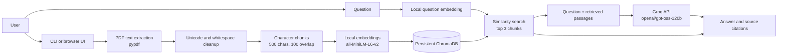

# Chat with PDFs

A local, multi-PDF question-answering app built to learn how Retrieval-Augmented
Generation (RAG) works. Use it from a Python command line or a browser interface
running on your computer. The app extracts text from PDFs, finds relevant
passages for a question, and asks a language model to answer from those
passages with filename and page citations.

The retrieval pipeline is implemented directly with Python libraries; this
project does not use LangChain, LlamaIndex, or another RAG framework.

For a detailed explanation of the architecture, workflows, functions,
endpoints, and responsibilities of each file, see the
[Project Guide](PROJECT_GUIDE.md).

## Features

- Index one PDF, a folder of PDFs, or PDFs uploaded through the browser UI.
- Search PDFs from any subject together.
- Run a terminal interface or a local browser interface.
- Create embeddings locally with `all-MiniLM-L6-v2`.
- Persist embeddings locally with ChromaDB.
- Generate answers with Groq's `openai/gpt-oss-120b` model.
- Show retrieved passages for debugging and cite the source PDF, page, and chunk.
- Configure chunk size, overlap, and number of retrieved chunks in the CLI.
- Keep browser uploads and their index across server restarts; remove a PDF and
  its indexed chunks from the UI.
- Run offline tests without calling Groq or downloading the embedding model.

## Requirements

- Python 3.10 or newer.
- A Groq API key.
- Internet access to install the Python packages, download the embedding model
  on its first use, and request answers from Groq.
- Text-based PDFs. Scanned/image-only documents are not supported because OCR
  is not included.

## Project layout

```text
p1-chat-pdf/
├── app.py              # RAG pipeline and command-line interface
├── web_app.py          # Local FastAPI server and JSON API
├── static/
│   ├── index.html      # Browser UI structure
│   ├── styles.css      # Browser UI styles
│   └── app.js          # Upload, chat, and source interactions
├── tests/
│   ├── test_app.py     # Offline RAG utility tests
│   └── test_web_app.py # Offline web API tests
├── requirements.txt    # Python dependencies
├── PROJECT_GUIDE.md    # Detailed architecture and file-by-file explanation
├── .gitignore          # Excludes secrets and local data
├── data/               # Optional PDFs for CLI use; create locally
├── user_documents/     # Browser uploads and manifest; created locally
└── chroma_db/          # Persistent Chroma data; created locally
```

Create a local `.env` file yourself; it is deliberately not included in the
repository and is ignored by Git. Local PDFs, uploads, vector data, and virtual
environments are also excluded from Git.

## Setup on Windows

Run these commands in PowerShell from the project folder:

```powershell
python -m venv venv
.\venv\Scripts\Activate.ps1
python -m pip install -r requirements.txt
notepad .env
```

If Notepad asks whether to create the file, choose **Yes**. Add your Groq key,
a private app password of at least 12 characters, and a session-signing secret:

```env
GROQ_API_KEY=your_groq_api_key
APP_PASSWORD=choose_a_private_password_at_least_12_characters
APP_SESSION_SECRET=paste_a_random_secret_here
APP_COOKIE_SECURE=false
```

Generate the session secret with:

```powershell
python -c "import secrets; print(secrets.token_urlsafe(48))"
```

Copy the printed value into `APP_SESSION_SECRET`. Save `.env` in the project
root. Do not add quotes, commit the file, or share any of these values. If a
key has ever been exposed, revoke it in Groq Console and replace it with a new
one.

## Run the browser interface

Start the local server from the project folder with the virtual environment
activated:

```powershell
python -m uvicorn web_app:app --host 127.0.0.1 --port 8000
```

Open [http://127.0.0.1:8000](http://127.0.0.1:8000), sign in with
`APP_PASSWORD`, and then drop PDFs into the sidebar or click **Add PDFs**.
Wait until each document says **Ready** and ask a question. Select a source
card to inspect its passage; **Open full page** opens the cited PDF page in
the browser's PDF viewer.

The browser UI accepts PDF files up to 50 MB each. Uploaded PDF files and a
local document manifest are stored under `user_documents/`. The web UI uses
the `web_pdf_chunks` Chroma collection and keeps it across restarts. Remove a
ready or failed document with its remove button; this deletes its local PDF
copy and its indexed chunks. A document cannot be removed while it is indexing.

Stop the server with `Ctrl+C`.

## Run the command-line interface

Put PDFs directly in `data/`, then pass the folder:

```powershell
python app.py data
```

By default, the CLI searches only PDFs directly inside the selected folder.
Use `--recursive` to include nested folders, or pass one PDF path:

```powershell
python app.py data --recursive
python app.py data\book.pdf
```

At the prompt, enter a question. The CLI prints its retrieved passages before
the answer, followed by source citations. Type `quit` to exit.

Tune retrieval and chunking from the command line:

```powershell
python app.py data --chunk-size 700 --overlap 120 --top-k 5
```

`--chunk-size` is the maximum chunk length in characters, `--overlap` is the
number of characters repeated between adjacent chunks, and `--top-k` is the
number of retrieved passages. The overlap must be smaller than the chunk size.
Defaults are 500, 100, and 3. These options apply to the CLI.

The CLI uses a separate `pdf_chunks` collection in `chroma_db/`; it deletes and
rebuilds that collection each time it starts. This is separate from the
persistent `web_pdf_chunks` collection used by the browser UI.

## System design



### Main components

| Component | Responsibility |
|---|---|
| `app.py` | Shared text-cleaning, chunking, indexing, retrieval, prompt-building, and Groq-call functions; also provides the CLI. |
| `web_app.py` | FastAPI routes for document upload/list/removal, PDF viewing, and question answering. |
| `static/` | Browser interface for managing documents, asking questions, and reading source passages. |
| `pypdf` | Extracts text page by page and provides page numbers for citations. |
| `sentence-transformers` | Converts passages and questions into local vectors using `all-MiniLM-L6-v2`. |
| ChromaDB | Stores vectors and source metadata on the local filesystem and retrieves similar passages. |
| Groq | Generates the answer from the question and retrieved context. |

### Indexing workflow

1. **Choose documents.** The CLI reads a file or scans a folder. The browser
   accepts one or more uploaded PDFs.
2. **Extract and clean.** `pypdf` extracts text page by page. Cleanup normalizes
   Unicode ligatures, joins words split by hyphens at line breaks, and tidies
   paragraph whitespace.
3. **Chunk and embed.** Each page is split into overlapping character chunks.
   The local sentence-transformer model creates one vector per chunk.
4. **Store with citations.** Chroma stores each vector with document filename,
   page number, and chunk number. The browser also stores a document ID so its
   chunks can be removed independently.
5. **Retrieve and answer.** For a question, the app embeds the question, finds
   the closest chunks, builds a context-only prompt, and sends the question
   plus those passages to Groq.
6. **Show evidence.** The UI displays the answer and source cards with PDF
   filenames and page numbers. The CLI prints retrieved chunks before the
   answer, including chunk numbers.

## API routes

The browser UI talks to the local FastAPI server:

| Method | Route | Purpose |
|---|---|---|
| `GET` | `/api/auth/status` | Check whether this browser has a valid session. |
| `POST` | `/api/auth/login` | Verify the app password and issue a session cookie. |
| `POST` | `/api/auth/logout` | Clear the current session cookie. |
| `GET` | `/api/documents` | List documents and their indexing status (authenticated). |
| `POST` | `/api/documents` | Upload PDFs and start indexing (authenticated). |
| `DELETE` | `/api/documents/{document_id}` | Remove a document and its vector chunks (authenticated). |
| `GET` | `/api/documents/{document_id}/file` | Open an uploaded PDF (authenticated). |
| `POST` | `/api/questions` | Retrieve passages and return an answer with sources (authenticated). |

Interactive API documentation is disabled so it cannot expose an unnecessary
public API surface.

## Privacy and security

- The browser server binds to `127.0.0.1` by default. Its document and
  question APIs require the password configured with `APP_PASSWORD`; sessions
  are signed, expire after 12 hours, and use HttpOnly/SameSite cookies.
- State-changing browser requests must have a matching same-origin `Origin`
  header. Login attempts are limited to five failures per IP per 15 minutes.
- Keep the server bound to localhost for local use. Authentication is a
  baseline safeguard, not a substitute for a hardened deployment. If putting
  it behind HTTPS, set `APP_COOKIE_SECURE=true`; do not expose it over plain
  HTTP on a public network. Protect `.env`, the host, and local PDF/index
  folders as well.
- Uploaded PDFs, extracted text, embeddings, and the Chroma index are stored
  locally.
- Each question and its retrieved passages are sent to Groq for generation.
  Do not ask questions about documents you are not allowed to share with that
  service.
- The Groq key belongs only in the ignored local `.env` file. Never put it in
  source code, README content, screenshots, or GitHub.
- The app does not OCR scanned pages, and its answers are not guaranteed to be
  complete or correct. Check the cited passages against the original PDF.

## Tests

Run the offline suite from the project root:

```powershell
python -m unittest discover -s tests -v
```

Tests cover text cleanup, chunking, CLI options, Chroma metadata and retrieval,
web API responses, and upload persistence. Groq calls and actual model
downloads are mocked or avoided; tests do not verify answer quality.

## Troubleshooting

- **`ModuleNotFoundError`**: Activate `venv`, then run
  `python -m pip install -r requirements.txt`.
- **Missing Groq key**: Check that the project-root `.env` contains
  `GROQ_API_KEY=...`, then restart the CLI or web server.
- **Web server reports missing security settings**: Add `APP_PASSWORD` (at
  least 12 characters) and a randomly generated `APP_SESSION_SECRET` (at
  least 32 characters) to the project-root `.env`, then restart the server.
- **PDF has no readable text**: It may be scanned or image-only. OCR is not
  included in this project.
- **An answer seems wrong**: Inspect the retrieved chunks/source cards. Retrieval
  can miss relevant context, and the language model can misinterpret passages.
- **Browser upload fails**: Use a `.pdf` file under the 50 MB per-file limit.
- **Web document is stuck in indexing after restart**: The app marks interrupted
  work as an error. Remove that entry and upload the PDF again.
- **First run is slow**: The embedding model is downloaded and initialized
  locally the first time.

## Possible future improvements

- OCR for scanned and image-only PDFs.
- Token-aware or heading-aware chunking and configurable settings in the browser.
- Better progress reporting, cancellation, and resumable indexing.
- A source viewer that highlights the exact retrieved passage on the PDF page.
- Optional answer-quality evaluation against a small reference question set.

## Resume summary

> Built a local multi-PDF RAG application with Python CLI and browser
> interfaces, using local sentence-transformer embeddings, persistent ChromaDB
> retrieval, and Groq-generated answers with PDF/page citations. Implemented
> document upload and lifecycle APIs, source-aware retrieval, and offline
> pipeline/API tests.

## License

No license is currently included. Unless a license is added, others do not
automatically have permission to reuse, modify, or redistribute this project.
